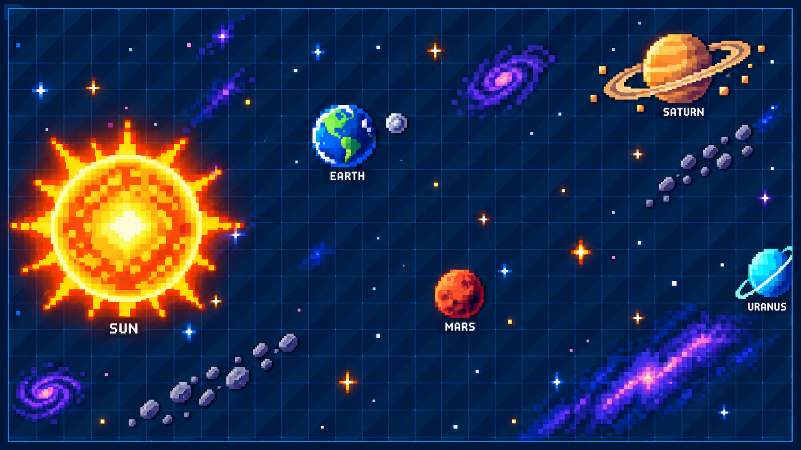
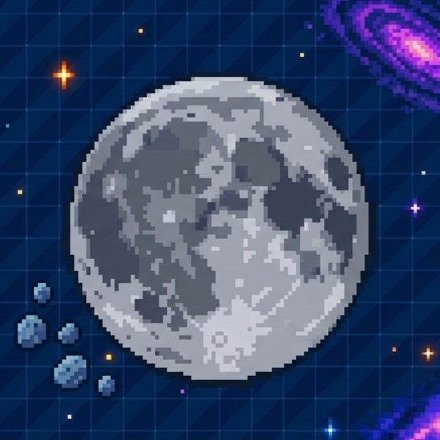
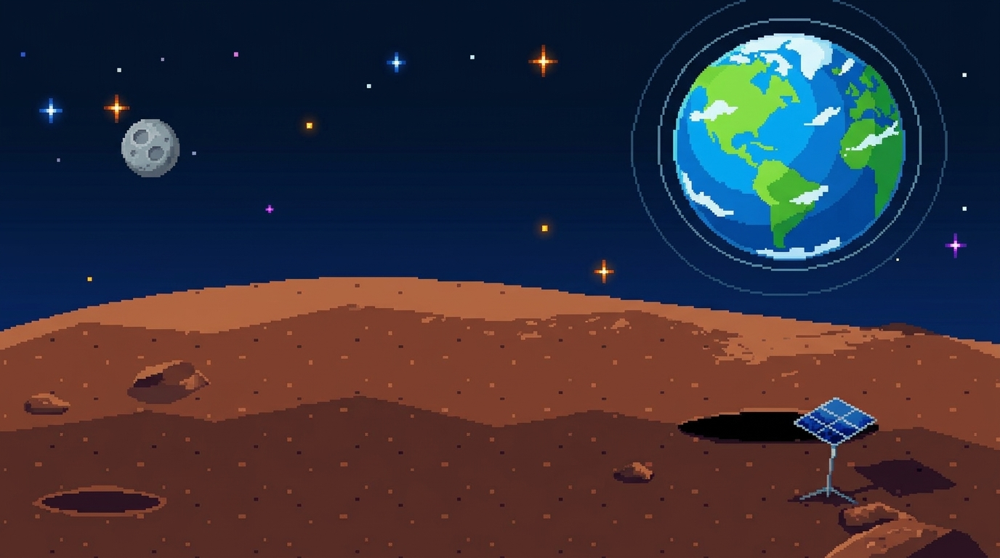
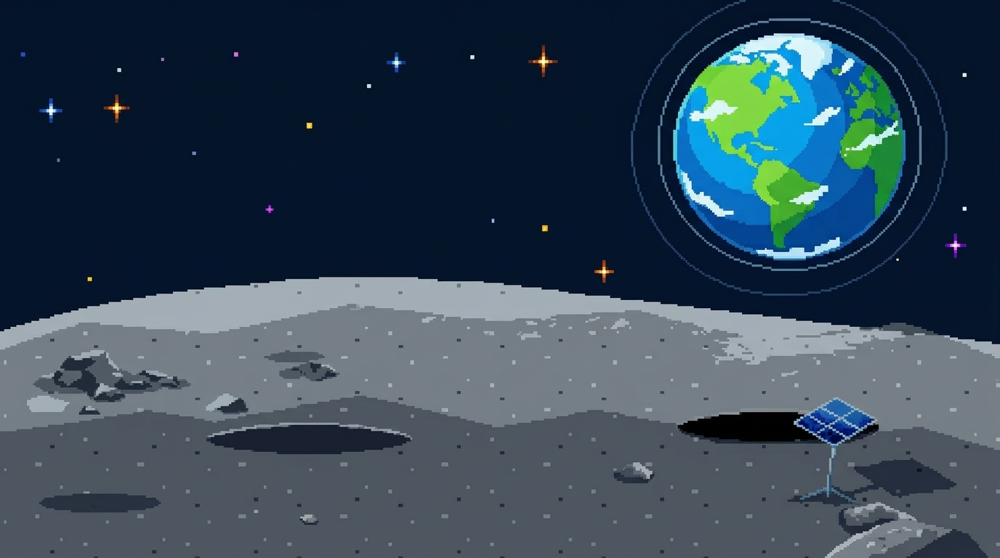

# NASA: Lost Missions

<p align="center">
  
  
  
</p>
> Interactive storytelling for the **NASA Space Apps Challenge 2026**: *Abandoned but not Forgotten: Storytelling about NASA's Discarded Equipment on the Moon and Mars*.

---

## 1. Project Overview

### 1.1. Project Summary

**NASA: Lost Missions** is a static, bilingual (EN/ES) web experience that turns NASA hardware left on Mars and the Moon into short, playable investigations. Players explore real mission sites with **R.O.M.**, connect instruments to discoveries, and unlock a codex that separates **NASA DATA** from **ARCHIVE SIMULATION** and **GAME EVENT**.

- **Playable MVP:** Spirit (MER-A, Gusev Crater) and Opportunity (MER-B, Meridiani Planum).
- **Coming soon:** Apollo 15 (lunar hardware: LRV, ALSEP, LRRR) — page/teaser only.

### 1.2. Executive Summary
Lost Missions helps families and students understand what was left behind, what it discovered, why it stayed, and its current status—using sourced NASA facts, clear labeling, and lightweight RPG-style exploration.
<p align="center">
  
</p>

### 1.3. Project Objectives and Expected Outcomes

- **Objective:** tell verified, engaging stories of equipment left on Mars/Moon.
- **Expected outcomes (MVP):** two playable RPG missions with sourced codex, Apollo 15 coming-soon page, EN/ES content, and validated static build.

### 1.4. Project Justification

The challenge calls for stories about discarded/left-behind NASA equipment. This project answers with an interactive, source-backed experience that preserves scientific context and legacy.

---

## 2. Project Demo

### 2.1. Demo Video

- **Demo video (YouTube / 30s):** *To be added*.

### 2.2. Quick Preview

Run the application locally and visit:

- `/` — Home.
- `/missions` — Mission map.
- `/story` — Spirit investigation.
- `/opportunity` — Opportunity investigation.

---

## 3. Project Links
- **Repository:** [NASA: Lost Missions - REPO](https://github.com/M4rc0HR/NASA-Lost-Missions)
- **Live site:** [NASA: Lost Missions - WEB](https://nasa-lost-missions.vercel.app/)

---

## 4. Project Description

### 4.1. What Does It Do?

- Presents Mars/Moon missions focused on hardware left behind.
- Lets players explore, inspect objects, solve labeled simulations/minigames, and answer questions.
- Unlocks a **codex** with mission facts, hardware status, images, and NASA source links.
- Supports **EN/ES** and clearly tags content provenance.

### 4.2. How Does It Work?

1. **Home (`/`):** introduces the archive and R.O.M.
2. **Mission map (`/missions`):** allows players to select a destination.
3. **RPG (`/story`, `/opportunity`):** drives investigations through dialogue, clues, and minigames. These engineering/science simulations do not change historical outcomes.
4. **Codex and sources:** verified facts/images are stored in JSON with `source_id`/URLs and shown with attribution.

### 4.3. Innovation and Purpose

- Storytelling centered on the **scientific legacy** of silent machines.
- Explicit separation of **fact vs. simulation vs. fiction** for trustworthy learning.

### 4.4. Methodology and Work Plan

| Phase                    | Main activities                                     | Intermediate deliverables                  |
| ------------------------ | --------------------------------------------------- | ------------------------------------------ |
| Definition               | Select missions/artifacts, narrative and data model | Initial `content/` mission schemas         |
| Web implementation       | Astro site, map, shared RPG engine, minigames       | `/`, `/missions`, `/story`, `/opportunity` |
| Data and sources         | Add verified facts/images with attribution          | Sourced JSON, gallery, codex, status       |
| i18n and review          | EN/ES, accuracy and UX fixes                        | Bilingual content, corrected sources/dates |
| Polish and documentation | Validation/build, documentation                     | Green checks, README                       |

*Examples:* sourced NASA data/images, date/state verification, progress screenshots.

---

## 5. Impact and Benefits

### 5.1. Social, Environmental, and Technological Benefits

- **Social/educational:** accessible space-science learning for non-experts.
- **Environmental (outreach):** context for past Martian environments (e.g. water-related evidence).
- **Technological:** highlights instruments, solar power, communication, and remote operations challenges.

### 5.2. Contribution to Sustainable Development Goals

- **SDG 4 (Quality Education)** and **SDG 9 (Industry, Innovation and Infrastructure)**.

### 5.3. Expected Community Impact

- Encourages curiosity and critical thinking by linking stories to primary NASA sources.

### 5.4. Relevance to NASA Missions

- Aligned with **NASA Mars Exploration Rovers (Spirit/Opportunity)** and **Apollo 15** hardware context (data/preparation).
- Communicates planetary and lunar exploration heritage using NASA data/images with attribution and clear fact/simulation boundaries.

---

## 6. Expected Results and Future Improvements

### 6.1. Expected Results

- Functional MVP (Spirit and Opportunity).
- Sourced codex.
- Apollo 15 teaser.
- Bilingual EN/ES content.
- Reproducible static build with validated content.

### 6.2. Conclusions and Lessons Learned

- Separating verified data from simulations and keeping per-fact sources improves trust and review.

### 6.3. Future Improvements
- Complete the Apollo 15 mission.
- Add more missions based on past NASA events.
- Add more minigames, characters, and interactive elements.
- Localize and optimize key images.
- Add comparison and educational layers.
- Configure CI and automated tests.

---

## 7. Project Team

### 7.1. Team Members and Roles

| Member | Role | Description |
| ------ | ---- | ----------- |
|        |      |             |

---

## 8. Technical Documentation

### 8.1. Project Architecture and Structure

The project uses a monorepo architecture with pnpm workspaces.

- `apps/web` — Astro site, components, shared RPG engine, and styles.
- `content/` — mission/copy data (source of truth).
- `apps/web/public/assets` — static assets, including R.O.M.

### 8.2. Tools and Software

- **Astro 4** — static site generation.
- **pnpm** — package and workspace management.
- **Node.js** — scripts and project tooling.
- **@astrojs/check** and **TypeScript** — static checks and type checking.
- **Git** — version control.

### 8.3. Programming Languages and Frameworks

- **Framework:** Astro.
- **Languages:** JavaScript/TypeScript, HTML, CSS, JSON.

### 8.4. Installation and Execution

Requirements: Node.js and Corepack.

```bash
corepack pnpm install
corepack pnpm run dev
```

The development server runs at `http://localhost:4321`.

### 8.5. Validation and Build

```bash
# Validate mission and content JSON files
corepack pnpm run validate

# Run Astro checks
corepack pnpm run typecheck

# Generate the static production build
corepack pnpm run build
```

Static output: `apps/web/dist`.

**Note:** No CI pipeline or automated tests are currently configured.

---

## 9. NASA Data and References

Key sources referenced in project content:

### 9.1. Spirit (MER-A)

- [NASA — Mars Exploration Rover Spirit](https://science.nasa.gov/mission/mer-spirit/).
- [PDS Geosciences Node — Mars Exploration Rover Mission](https://pds-geosciences.wustl.edu/missions/mer/).
- [NASA — Mars Exploration Rovers Science Highlights](https://science.nasa.gov/mission/mars-exploration-rovers-spirit-and-opportunity/science-highlights/).
- [NASA Photojournal — Rover Wheel Churns Up Bright Martian Soil](https://science.nasa.gov/photojournal/rovers-wheel-churns-up-bright-martian-soil-stereo/).

### 9.2. Opportunity (MER-B)

- [NASA — Mars Exploration Rover Opportunity](https://science.nasa.gov/mission/mer-opportunity/).
- [NASA — Opportunity Rover Mission Comes to an End](https://science.nasa.gov/missions/mer/nasas-opportunity-rover-mission-on-mars-comes-to-end/).
- [PDS Geosciences Node — Mars Exploration Rover Mission](https://pds-geosciences.wustl.edu/missions/mer/).
- [NASA — Opportunity's Last Message](https://science.nasa.gov/resource/opportunitys-last-message/).

### 9.3. Apollo 15

- [NASA NSSDC — Apollo Lunar Roving Vehicle](https://nssdc.gsfc.nasa.gov/planetary/lunar/apollo_lrv.html).
- [NASA NSSDC — Apollo 15 Spacecraft](https://nssdc.gsfc.nasa.gov/nmc/spacecraft/display.action?id=1971-063C).
- [NASA NSSDC — Apollo 15 Experiment](https://nssdc.gsfc.nasa.gov/nmc/experiment/display.action?id=1971-063C-08).

**Data attribution:** Facts shown as `NASA DATA` include source links; image credits are maintained with the corresponding content.

---

## 10. Appendices

### 10.1. Mission Map

<p align="center">
&#x20;
</p>

### 11.2. Planetary Environments

<p align="center">
  
  
</p>

<p align="center">
  
  
</p>
